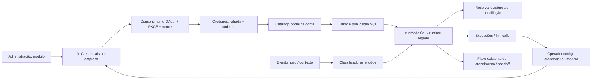

# IA por empresa e classificadores — porte seletivo, 2026-10-16

Esta edição preserva a criação conversacional de agentes, presets, marca, histórico
importado de WhatsApp, cotas e conciliação de IA. Os novos modelos são opções;
nenhum padrão existente é promovido ou substituído.

## Operação

O módulo `login_codex` nasce **desligado**. Em Administração → Sistema, sua
ativação exige que o operador confirme a elegibilidade da instalação: a oferta
pública para aplicações open source e auto-hospedadas não habilita automaticamente
um SaaS pago ou hospedado remotamente. A interface aponta a
[documentação oficial de elegibilidade](https://developers.openai.com/siwc/token-sharing-open-source).
Não foi realizado consentimento OAuth nem habilitação real em produção neste porte.

Quando habilitado, um administrador da empresa pode conectar a própria conta em
IA → Credenciais, com MFA quando exigido pela política local. O fluxo usa PKCE,
state assinado para usuário/empresa, nonce de uso único e validação do ID token
(assinatura JWKS, issuer, audience, nonce e subject). A troca usa exclusivamente
o endpoint OAuth oficial. O envelope cifrado é guardado na credencial da mesma
empresa; leitores genéricos de API key o recusam. Listar modelos requer gestor.

A lista vem do catálogo da conta, sem copiar preços ou modelos para outra empresa.
Uma falha de rede ou autorização fica visível como falha de catálogo e não apaga o
espelho válido. Não haver credencial continua sendo um estado diferente. Ao
publicar uma versão, a função SQL valida o modelo contra o espelho da credencial
selecionada, mantendo os demais controles de organização, papel, proveniência,
canal, orçamento e bloqueio concorrente.

A inferência usa a Responses API pública, com streaming e `store:false`. Só uma
resposta terminada com sucesso é consumida pelo turno. Falha após ferramenta
iniciada não repete automaticamente a operação. Antes disso, a reserva pode usar
uma chave OpenAI já autorizada para a empresa/instalação; orçamento, franquia,
evidência e conciliação são aplicados novamente a cada tentativa. Custo não
comprovado permanece em conferência, nunca vira custo zero fictício. O runtime
legado mantém sua finalização de falha; não se promete fallback de erro de rede
nesse caminho.

Access tokens SIWC duram uma hora. A renovação automática ocorre nos últimos
cinco minutos e respeita `earliest_refresh_at`, com trava no banco para evitar
rotação simultânea por app/worker. Referências:
[token reference](https://developers.openai.com/siwc/token-sharing-open-source/token-reference),
[models and inference](https://developers.openai.com/siwc/token-sharing-open-source/models-and-inference).

Classificação de estágio e guardrails evitam reclassificar o mesmo turno; leituras
independentes podem correr em paralelo. Modelos econômicos só são escolhidos
quando o motor conhece o preço e o provedor admite os parâmetros. O julgamento
já calculado é reutilizado. Sentimento roda quando pode alimentar o alerta, sem
bloquear a entrada do webhook.

## Migrações e preços

- 0424 substitui somente `fn_publish_ai_agent_version(uuid,uuid,uuid,boolean,text)`.
  Não cria tabelas, políticas ou colunas. `EXECUTE` continua exclusivo de
  `service_role`; `PUBLIC`, `anon` e `authenticated` são revogados explicitamente.
- 0425 e 0426 inserem GPT-6 Luna, GPT-6.1 Sol, GPT-6 Astra e Claude Haiku/Sonnet/Opus
  5.5, com `ON CONFLICT DO NOTHING` para preservar personalizações e defaults.
- O baseline inclui os três blocos antes da varredura final de ACL; o deploy
  produtivo usa o pacote incremental controlado, nunca reaplica o baseline.

Preços Standard consultados em 2026-10-16 nas páginas oficiais
[OpenAI](https://developers.openai.com/api/docs/pricing) e
[Anthropic](https://platform.claude.com/docs/en/about-claude/pricing).
O cálculo preserva cache/tier por chamada e considera a faixa longa do Haiku 5.5.
As três entradas GPT novas usam regras de reasoning/temperature compatíveis; a
opção explícita de classificação não é sobrescrita pelo padrão de ambiente.

## Mapa e Living System Checklist

1. Entrada: estado autenticado, organização ativa e token consentido; contexto do
   turno permanece tenant-scoped em `get-lead-context` e `inbound-turn`.
2. Saída: catálogo → seletores/publicação; credencial → `runModelCall` e runtime.
3. Registro: `ai.login_codex_conectado/desconectado`, rotação de credencial,
   `llm_calls` e evidência/reserva de franquia.
4. Tela: IA → Credenciais, editor de agentes, Execuções e Uso & Custo existentes.
5. Porta: Administração → Sistema e navegação IA existente; sem nova rota oculta.
6. Anti-morte: falha registrada com opção de corrigir credencial/modelo; retomada
   segue tratamento de erro/handoff existente. Não há mensagem automática nova.
7. Configuração: módulo desligado por padrão e painel explica elegibilidade;
   modelos da empresa aparecem nos seletores quando disponíveis.
8. Continuidade: preserva caminhos IA↔humano existentes; não ativa agentes,
   publica versões ou envia mensagens no porte.
9. Retorno: falha de autorização/cota orienta correção; falha após ferramenta
   impede repetição que duplicaria efeitos; custo incerto vai à conferência.
10. Mapa atualizado acima, com entrada, execução, evidência e retorno ao operador.

## Origem e validação

Porte da referência estável `melgarafael/DeskcommCRM` v1.82.0, com adaptação para
esta edição. Créditos preservados a melgarafael, webtecnica e Rafael César Rocha
Monteiro. Fontes principais: 71e36e05f, 621b376ba, d7b3a05db, a97851f69,
bbe3d6c68, 401807ad3, 989a4db52, 02a4a7832; b3ad49151, 652ed368f,
66f11e00e, 46a0dd440, e437d7245, 5503592f0, 4ade3adbf, 61c8f7844,
06578aafb, 4f3485283, dd7247282, 542b008f7; 262639f75, 25bd3f751,
523d2f59f, f2c889327 e 8e643a6a2. As dependências SDK foram atualizadas junto
com o lockfile; o comportamento de streaming é provado com SDK real sem rede.

Os testes cobrem isolamento/nonce/MFA, catálogo e erro sanitizado, reserva e
fallback, renovação/concorrência, terminal de stream e veto de repetição de tools,
preços/tier e classificadores. O invariante SQL verifica publicação com catálogo
por credencial. Validação real de consentimento, elegibilidade e uso de uma conta
permanece dependente da operação autorizada após CI/deploy.
